# CricketVerse: 30-Day Project Delivery Roadmap
**Author:** Tejaswini Kunkulagunta (CS23B032)  
**Academic Year:** 2026  
**Project:** CricketVerse — A Decentralized Web3 Cricket Ecosystem  

---

## Executive Overview & Timeline Compression
The original project proposal outlined an ambitious **16-week academic roadmap**. To meet an accelerated **30-day final submission deadline**, the project timeline has been compressed into **three focused 10-day sprints**.

```mermaid
gantt
    title CricketVerse 30-Day Accelerated Delivery Roadmap
    dateFormat  X
    axisFormat  Day %d
    section Phase 1 (Days 1–10)
    SRS, Schemas & Hardhat Setup :active, d1, 0, 3
    Solidity Smart Contracts (CRIC, dNFT, Tickets, Market) :active, d2, 3, 7
    100% Test Coverage Suite & Hybrid Express API :active, d3, 7, 9
    Interactive Web3 DApp Prototype :active, d4, 9, 10
    section Phase 2 (Days 11–20)
    Chainlink Functions & Live Cricket API Feeds :d5, 10, 14
    Dockerized Hybrid DB (PostgreSQL / MongoDB) :d6, 13, 17
    On-Chain SVG Metadata & Tournament Escrow Pools :d7, 16, 20
    section Phase 3 (Days 21–30)
    Polygon Amoy Testnet Deployment & Etherscan Verification :d8, 20, 24
    Static Analysis (Slither) & Gas Optimization :d9, 23, 27
    Academic Project Report, Defense Deck & Final Submission :d10, 27, 30
```

---

## 🎯 Phase 1: Days 01–10 (CURRENT SPRINT — 100% COMPLETED)
**Milestone Focus:** Core Smart Contract Infrastructure, Comprehensive Unit Testing, Deterministic Scoring Engine, and Interactive Web3 DApp.

### 1. Smart Contract Suite (`contracts/`)
* **`CRIC.sol` (ERC-20)**:
  * Platform utility token with max supply cap (100,000,000 CRIC).
  * Initial genesis allocation (10,000,000 CRIC) for liquidity and prize distribution.
  * Interactive rate-limited test faucet (`claimFaucet()`, 1,000 CRIC / hr cooldown).
  * Access-controlled minting permissions for tournament engines.
* **`PlayerCardNFT.sol` (ERC-1155 Dynamic NFT - dNFT)**:
  * 5 tiered rarities: **Common** (1.0x), **Uncommon** (1.1x), **Rare** (1.25x), **Epic** (1.5x), and **Legendary** (2.0x).
  * Hard supply caps: Legendary (max 25), Epic (max 250), Rare (max 1,000), Uncommon (max 5,000).
  * Dynamic telemetry update function (`updatePlayerStats`) allowing oracles to mutate runs, wickets, strike rate, and economy.
* **`MatchTicketNFT.sol` (ERC-721 Anti-Scalping Ticket)**:
  * Enforced resale price ceiling: secondary transfer price strictly capped at **maximum 15% above face value** (`MAX_MARKUP_BPS = 11500`).
  * One-time turnstile redemption (`redeemTicket`) callable only by authorized `GATEKEEPER_ROLE`.
  * Permanent on-chain state transition to eliminate double-entry fraud.
* **`CricketMarketplace.sol`**:
  * Trustless, non-custodial atomic settlement for cards and tickets.
  * ReentrancyGuard and OpenZeppelin escrow security.
  * Enforced 5% secondary royalty split routed directly to card drop / venue organizer pools.
  * Rejection of scalped ticket listings exceeding the 15% markup cap.

### 2. Automated Smart Contract Test Suite (`test/CricketVerse.test.js`)
* **13 unit tests passed with 100% success rate** on local Hardhat EVM (Cancun target):
  * Faucet claims, cooldown restrictions, and supply cap bounds.
  * PlayerCard NFT rarity multiplier calculation and Legendary supply cap enforcement.
  * Dynamic stats upgrade telemetry verification.
  * Anti-scalping 15% price ceiling validation (allowing $\le 115\%$, reverting $>115\%$).
  * Turnstile single-entry redemption and duplicate redemption rejection.
  * Marketplace atomic swap and 5% royalty fee distribution.

### 3. Backend REST Engine (`server/`)
* **`server/scoringEngine.js`**:
  * Deterministic scoring engine adhering to proposal Section 5.4: Runs (+1), 4s (+1), 6s (+2), Wickets (+20), Catches (+8), 50s (+10), 100s (+25).
  * Applied rarity multipliers (1.0x to 2.0x).
  * 100 virtual salary cap squad validation (11 players, role minimums: 1 WK, 3 BAT, 3 BOWL, 1 AR).
* **`server/server.js`**:
  * Live match telemetry simulator endpoint (`/api/fantasy/simulate-over`).
  * Ticket resale compliance check endpoint (`/api/tickets/validate-resale`).
  * Gate turnstile QR redemption endpoint (`/api/tickets/redeem`).
  * Fan polls with instant CRIC token claims (`/api/polls/vote`).

### 4. Interactive Web3 DApp Dashboard (`public/`)
* Authentic cricket-themed user experience (Pitch Turf Green, Bleed Blue, Cricket Ball Red, Willow Gold).
* Interactive wallet role switcher (Fan, Trader, Gatekeeper, Admin).
* Holographic dynamic player card gallery with live stat telemetry.
* Live fantasy squad builder with salary budget meter and real-time over simulator.
* Turnstile gate scanner with animated laser feedback and audit log.

---

## 🎯 Phase 2: Days 11–20 (CURRENT SPRINT — 100% COMPLETED)
**Milestone Focus:** Chainlink Oracle Automation, Tournament Escrows, Dynamic On-Chain SVG Vector Art, and Dockerized Hybrid Storage.

1. **Chainlink Functions Sports Oracle Integration (`contracts/CricketOracleConsumer.sol`)**:
   * Authored decentralized oracle consumer contract based on Chainlink Functions architecture.
   * Dispatches sports API telemetry requests (`requestMatchStats`) targeting CricAPI/Sportradar feeds.
   * Cryptographically verifies relayer authorization before updating `PlayerCardNFT.updatePlayerStats`.
   * Rejects unauthorized callers, prevents replay double fulfillment, and supports batch post-match settlement.
2. **Tournament Escrow Prize Pool Smart Contract (`contracts/TournamentPool.sol`)**:
   * Non-custodial fantasy tournament manager locking CRIC entry stakes in escrow.
   * Programmatically disburses prize pools: transparent 5% platform fee to ecosystem treasury (`PLATFORM_FEE_BPS = 500`), and remaining 95% net pool disbursed to verified top leaderboard managers.
   * Rain / Abandonment Protection: automated 100% full refund (`claimRefund`) if match is abandoned or washed out.
   * Complete reentrancy protection via OpenZeppelin `ReentrancyGuard` and Checks-Effects-Interactions (CEI).
3. **Dynamic On-Chain SVG Vector Card Visuals (`contracts/CardSVGGenerator.sol`)**:
   * Pure on-chain SVG renderer producing dynamic vector artwork encoded in RFC-2397 base64 Data URIs.
   * Tiered glowing palettes: Legendary Gold (`#F59E0B`), Epic Purple (`#8B5CF6`), Rare Cyan (`#0EA5E9`), Uncommon Emerald (`#10B981`), Common Slate (`#64748B`).
   * Real-time athletic milestone badge triggers:
     * **CENTURION 100+**: runs $\ge 100$
     * **HALF-TON 50+**: runs $\ge 50$
     * **5-WKT HAUL**: wickets $\ge 5$
     * **STRIKE MASTER**: strike rate $\ge 140.00$
     * **ECONOMY KING**: economy $\le 6.50$
4. **Dockerized Hybrid Off-Chain Infrastructure (`docker-compose.yml`, `server/schema.sql`, `server/db.js`)**:
   * Multi-service stack running PostgreSQL 16 Alpine, Redis 7 Alpine, and Express API.
   * Relational schema with 6 tables (`match_fixtures`, `player_telemetry`, `ball_telemetry`, `fantasy_squads`, `tournament_contests`, `oracle_audit_logs`).
   * Sub-second Redis leaderboard caching with instant sorting and rank lookups.
5. **Comprehensive Automated Test Suite (`test/Phase2_Ecosystem.test.js`)**:
   * Expanded test suite: **27 unit tests passed with 100% success rate in 860ms** on Hardhat EVM (Cancun target, `viaIR: true`, optimizer 200 runs).
6. **Deployment Automation (`scripts/deploy_phase2.js`)**:
   * Multi-target deployment script deploying CRIC, PlayerCardNFT, CardSVGGenerator, CricketOracleConsumer, and TournamentPool.

---

## 🎯 Phase 3: Days 21–30 (Final Sprint & Project Submission)
**Milestone Focus:** Public Testnet Deployment, Formal Security Auditing, Performance Benchmarks, and Thesis Defense.

1. **Polygon Amoy Testnet Deployment (Days 21–23)**:
   * Fund deployment wallet via Polygon Amoy Faucet.
   * Deploy `CRIC.sol`, `PlayerCardNFT.sol`, `MatchTicketNFT.sol`, and `CricketMarketplace.sol` to Polygon Amoy.
   * Verify source code on Polygonscan block explorer.
2. **Security Auditing & Gas Optimization (Days 24–25)**:
   * Run Slither static analysis and fix any high/medium warnings.
   * Profile gas costs per transaction (e.g. listing, buying, turnstile check-in) using Hardhat Gas Reporter.
3. **Turnstile Mobile Gatekeeper PWA (Days 26–27)**:
   * Mobile-optimized Progressive Web App (PWA) with HTML5 Camera QR scanner for real-time turnstile operation.
4. **Academic Project Report & Defense Deck (Days 28–30)**:
   * Final B.Tech project thesis document formatted according to department guidelines.
   * Benchmark charts: gas consumption vs centralized server costs, fraud prevention metrics.
   * Video demonstration walkthrough and live project presentation deck.
